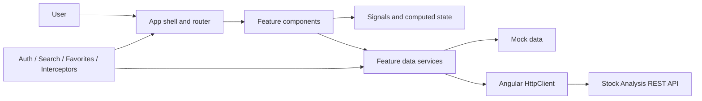

# Stock Analysis Frontend

以 Angular 建立的台股分析介面，將目標價估值、企業財務體質、股價趨勢、股票搜尋與收藏整合成 responsive 單頁應用程式。畫面狀態以 Signals 管理，資料存取集中在 feature service，並可在 mock data 與 REST API 之間切換。

An Angular-based Taiwan stock analysis interface that combines target-price valuation, company financial health, price trends, stock search, and favorites in a responsive single-page application. UI state is managed with Signals, data access is centralized in feature services, and the application can switch between mock data and a REST API.

搭配的 Spring Boot 後端請參閱 [`stock-analysis-back-end-public`](https://github.com/Adam-Chung/stock-analysis-back-end-public)。

See [`stock-analysis-back-end-public`](https://github.com/Adam-Chung/stock-analysis-back-end-public) for the companion Spring Boot backend.

## 核心功能

### Key features

- **目標價分析**：呈現六段估值價位、目前價格差距、近十年高低點、殖利率與週 K 線趨勢。<br>
  **Target-price analysis**: Presents six valuation tiers, the gap from the current price, ten-year highs and lows, dividend yield, and weekly candlestick trends.
- **企業體質檢視**：依一般企業或銀行模板顯示財務指標、近五季數值、達標狀態與使用者筆記。<br>
  **Company health checks**: Displays financial indicators, values from the latest five quarters, pass/fail status, and user notes using either the general-company or bank template.
- **股票搜尋與收藏**：可依代號或名稱搜尋、切換收藏狀態，並在獨立頁面批次更新收藏股票。<br>
  **Stock search and favorites**: Supports search by stock code or name, favorite-state toggling, and batch updates for favorite stocks on a dedicated page.
- **按需 AI 建議**：由使用者主動觸發目標價或企業體質建議，畫面同時顯示上次更新時間。<br>
  **On-demand AI suggestions**: Lets users explicitly request target-price or company-health suggestions and displays the most recent update time.
- **Responsive layout**：提供桌面側欄、手機漢堡選單及適應不同寬度的估值與財務資料版面。<br>
  **Responsive layout**: Provides a desktop sidebar, a mobile hamburger menu, and valuation and financial-data layouts that adapt to different screen widths.
- **Mock mode**：內建股票、估值、週 K、企業體質與收藏資料，不連接後端也能瀏覽主要流程。<br>
  **Mock mode**: Includes stock, valuation, weekly candlestick, company-health, and favorite data so users can explore the main flows without a backend connection.

## 前端架構

### Frontend architecture



- **App shell**：負責 responsive navigation、全域股票搜尋、收藏清單與路由出口。<br>
  **App shell**: Handles responsive navigation, global stock search, the favorites list, and the router outlet.
- **Feature components**：目標價、企業體質、收藏更新與專案介紹各自維持畫面責任；原型登入程式目前預設停用並保留供後續擴充。<br>
  **Feature components**: Keep target-price analysis, company health checks, favorite updates, and project information in separate UI responsibilities. Prototype login code is currently disabled by default and retained for future extension.
- **Signals**：管理 loading、展開狀態、表單值與衍生估值顯示；`computed` 集中處理 UI 衍生資料。<br>
  **Signals**: Manage loading, expanded states, form values, and derived valuation displays, while `computed` centralizes derived UI data.
- **Data services**：統一 feature 的 HTTP 呼叫、mock 分支及 API response 到 view model 的轉換。<br>
  **Data services**: Centralize feature HTTP calls, mock branches, and API-response-to-view-model conversion.
- **Core services**：集中處理驗證、股票搜尋、收藏狀態與 correlation-aware API logging。<br>
  **Core services**: Centralize authentication, stock search, favorite state, and correlation-aware API logging.

## 頁面路由

### Application routes

| 路徑 / Path | 功能 / Purpose |
|---|---|
| `/target-price/:stockId` | 股票目標價與週 K 分析<br>Stock target-price and weekly candlestick analysis |
| `/health-check/:stockId` | 企業財務體質檢視<br>Company financial health check |
| `/favorite-update` | 收藏股票批次更新<br>Batch update for favorite stocks |
| `/about` | 分析流程與使用說明<br>Analysis workflow and usage information |
| `/login` | 原型登入（目前預設停用，會導回目標價頁）<br>Prototype login, currently disabled by default and redirected to the target-price page |

## 技術棧

### Technology stack

- Angular 22、TypeScript 6.0
- Angular Signals、Router、HttpClient
- PrimeNG、PrimeIcons、SCSS
- Vitest、jsdom

## 本機執行

### Running locally

需求：Node.js 與 npm。

Requirements: Node.js and npm.

```powershell
npm ci
npm start
```

開啟 `http://localhost:4200`。預設環境設定啟用 `useMockApi: true`，因此不需要後端或真實憑證即可操作主要頁面。

Open `http://localhost:4200`. The default environment enables `useMockApi: true`, so the main pages can be explored without a backend or real credentials.

執行驗證：

Run the verification commands:

```powershell
npm test -- --no-watch
npm run build
npm audit --audit-level=moderate
```

## 設定與限制

### Configuration and limitations

- 如需連接 REST API，請將環境設定的 `useMockApi` 關閉，並把 `apiBaseUrl` 指向自己的後端服務。<br>
  To connect to a REST API, disable `useMockApi` in the environment configuration and point `apiBaseUrl` to your own backend service.
- 現有 browser token storage 與 simple auth 是單一使用者原型，不符合 production 安全要求，不應直接暴露於公網。<br>
  The current browser token storage and simple auth are single-user prototypes that do not meet production security requirements and must not be exposed directly to the public internet.
- Mock data 只用於展示互動與版面，不代表即時市場或財務資訊。<br>
  Mock data demonstrates interactions and layout only; it does not represent live market or financial information.
- AI 與財務分析內容僅供研究參考，不構成投資建議。<br>
  AI and financial analysis content is for research purposes only and does not constitute investment advice.

## 資料使用責任

### Data-use responsibilities

畫面連接後端後可呈現市場、財務與 AI 內容。啟用任何第三方資料來源前，使用者必須自行確認目前的 Terms of Service、API 或資料 License、`robots.txt`、rate limit、attribution、隱私、AI processing 與再散布限制。可公開存取不代表已取得使用授權；授權不明時應維持停用。

When connected to the backend, the interface can present market, financial, and AI-generated content. Before enabling any third-party data source, users must independently verify the current Terms of Service, API or data License, `robots.txt`, rate limits, attribution requirements, privacy obligations, AI-processing terms, and redistribution restrictions. Public accessibility does not imply authorization to use the data; sources with unclear authorization should remain disabled.

## 授權條款

### License

本 repository 採用自訂的 [Non-Commercial Personal Use License 1.0](LICENSE)，僅允許個人基於非商業目的下載、執行及私人修改。禁止商業使用、收費代管，以及散布原始或修改後的版本。本專案屬於 source-available software，並非 Open Source software。

This repository uses the custom [Non-Commercial Personal Use License 1.0](LICENSE). It permits individuals to download, run, and privately modify the software only for non-commercial purposes. Commercial use, paid hosting, and distribution of original or modified versions are prohibited. This project is source-available software, not Open Source software.
