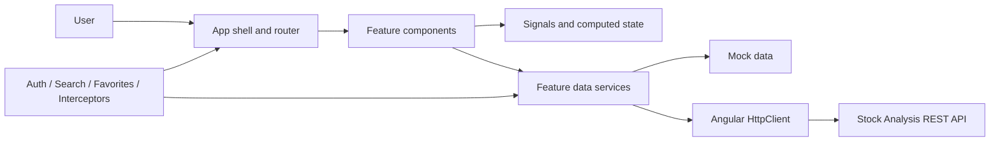

# Stock Analysis Frontend

以 Angular 建立的台股分析介面，將目標價估值、企業財務體質、股價趨勢、股票搜尋與收藏整合成 responsive 單頁應用程式。畫面狀態以 Signals 管理，資料存取集中在 feature service，並可在 mock data 與 REST API 之間切換。

## 核心功能

- **目標價分析**：呈現六段估值價位、目前價格差距、近十年高低點、殖利率與週 K 線趨勢。
- **企業體質檢視**：依一般企業或銀行模板顯示財務指標、近五季數值、達標狀態與使用者筆記。
- **股票搜尋與收藏**：可依代號或名稱搜尋、切換收藏狀態，並在獨立頁面批次更新收藏股票。
- **按需 AI 建議**：由使用者主動觸發目標價或企業體質建議，畫面同時顯示上次更新時間。
- **Responsive layout**：提供桌面側欄、手機漢堡選單及適應不同寬度的估值與財務資料版面。
- **Mock mode**：內建股票、估值、週 K、企業體質與收藏資料，不連接後端也能瀏覽主要流程。

## 前端架構



- **App shell**：負責 responsive navigation、全域股票搜尋、收藏清單與路由出口。
- **Feature components**：目標價、企業體質、收藏更新、登入與專案介紹各自維持畫面責任。
- **Signals**：管理 loading、展開狀態、表單值與衍生估值顯示；`computed` 集中處理 UI 衍生資料。
- **Data services**：統一 feature 的 HTTP 呼叫、mock 分支及 API response 到 view model 的轉換。
- **Core services**：集中處理驗證、股票搜尋、收藏狀態與 correlation-aware API logging。

## 頁面路由

| 路徑 | 功能 |
|---|---|
| `/target-price/:stockId` | 股票目標價與週 K 分析 |
| `/health-check/:stockId` | 企業財務體質檢視 |
| `/favorite-update` | 收藏股票批次更新 |
| `/about` | 分析流程與使用說明 |
| `/login` | 單一使用者原型登入 |

## 技術棧

- Angular 21、TypeScript 5.9
- Angular Signals、Router、HttpClient
- PrimeNG、PrimeIcons、SCSS
- Vitest、jsdom

## 本機執行

需求：Node.js 與 npm。

```powershell
npm ci
npm start
```

開啟 `http://localhost:4200`。預設環境設定啟用 `useMockApi: true`，因此不需要後端或真實憑證即可操作主要頁面。

驗證：

```powershell
npm test -- --no-watch
npm run build
npm audit --audit-level=moderate
```

## 設定與限制

- 如需連接 REST API，請將環境設定的 `useMockApi` 關閉，並把 `apiBaseUrl` 指向自己的後端服務。
- 現有 browser token storage 與 simple auth 是單一使用者原型，不符合 production 安全要求，不應直接暴露於公網。
- Mock data 只用於展示互動與版面，不代表即時市場或財務資訊。
- AI 與財務分析內容僅供研究參考，不構成投資建議。

## 資料使用責任

畫面連接後端後可呈現市場、財務與 AI 內容。啟用任何第三方資料來源前，使用者必須自行確認目前的 Terms of Service、API 或資料 License、robots.txt、rate limit、attribution、隱私、AI processing 與再散布限制。可公開存取不代表已取得使用授權；授權不明時應維持停用。

## No License

目前未授予本 repository 內容的使用、修改或散布權利。尚未提供正式 `LICENSE`；任何重用前請先取得 repository owner 的許可。
